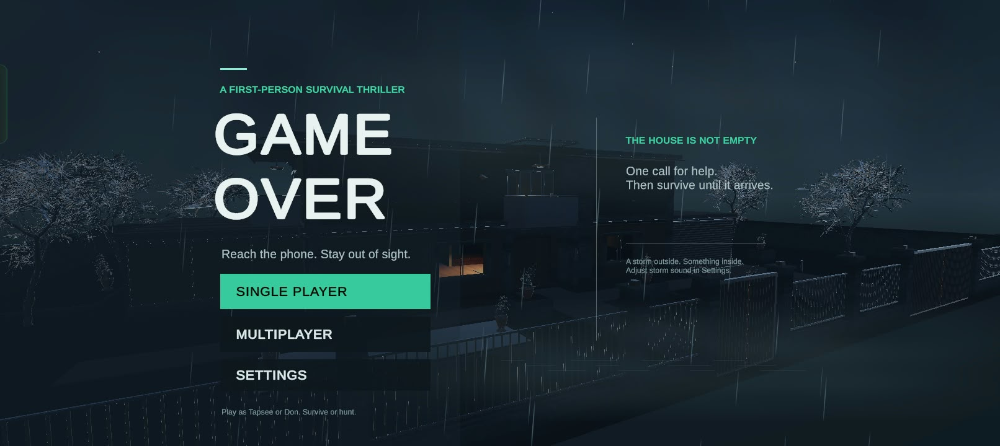
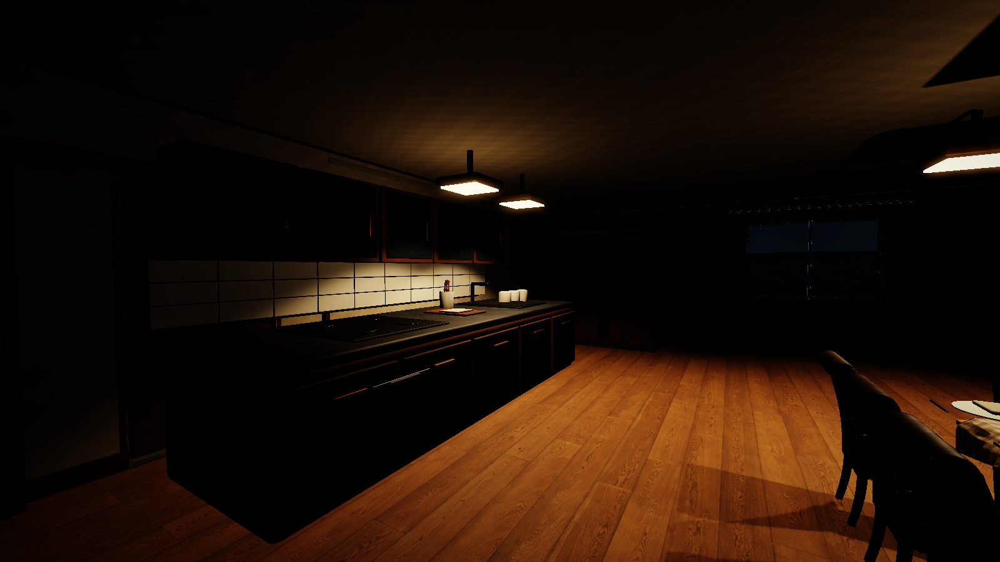
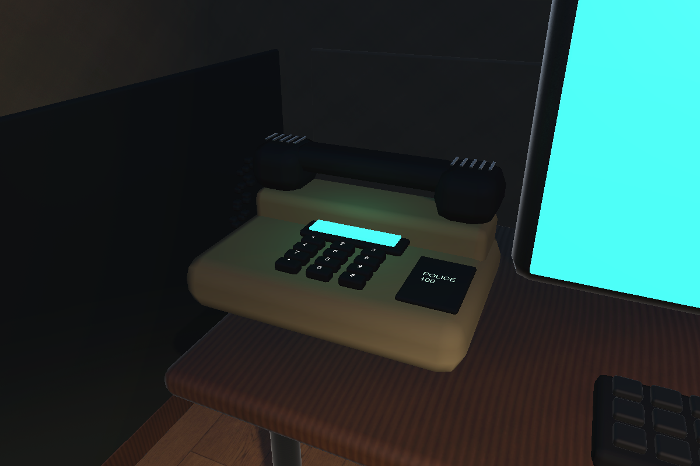

# GAME OVER

A first-person survival thriller set in a mansion during a storm. Play solo against AI or play opposite roles over a local network.

## My contribution

I developed the Unity prototype for a student group project. My work includes first-person movement and touch controls, the solo AI and two-player LAN flow, and the interactive mansion systems.

- **Solo AI and opposing roles:** Tapsee looks for a way to call for help while Don searches the mansion. In solo mode the AI takes the other role.
- **LAN play:** A six-digit room code connects two players on the same network. The host controls shared match state, including entry timing, power, and the rescue countdown.
- **Environmental gameplay:** The breaker controls power, batteries limit flashlight use, and the mansion provides hiding spots, security cameras, and motion sensors.
- **Mode-specific objectives:** The emergency phone is in the living room in solo play and in the basement office in multiplayer.

| Mansion interior | Basement office phone |
| --- | --- |
|  |  |

Screenshots are from the Unity project. The mansion includes third-party assets. This showcase contains images and project notes.
