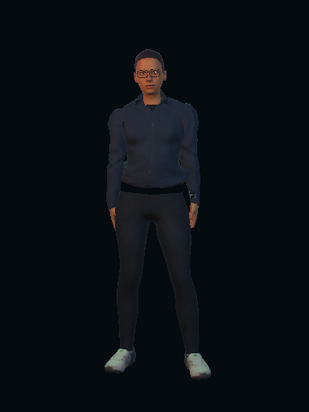
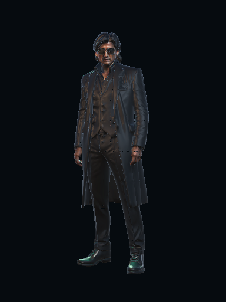
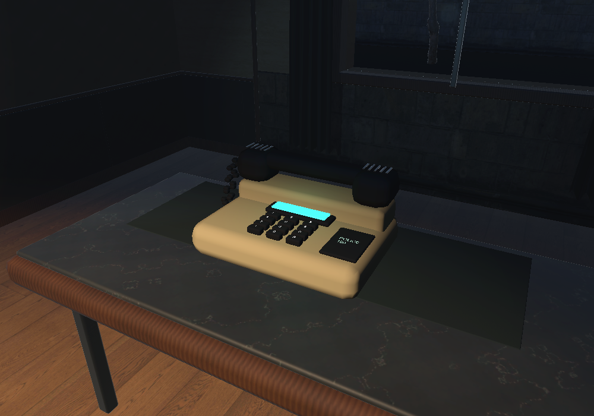
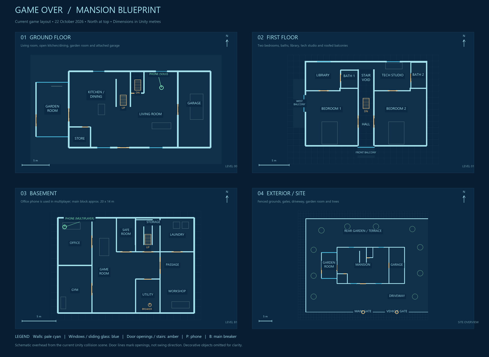
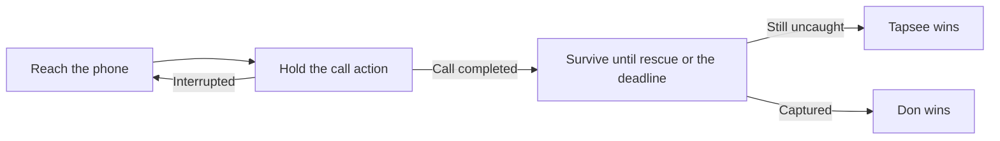

# GAME OVER

**One mansion. Two opposing roles. Six minutes.**

GAME OVER is a first-person survival thriller built in Unity. As Tapsee, get to the phone and stay hidden until help arrives. As Don, search the mansion and catch her before rescue. Play either role against AI, or face another player over LAN.

[See the roles](#two-ways-to-play) · [Explore the mansion](#inside-the-mansion) · [Read the engineering breakdown](#what-i-built)

## Two ways to play

| Tapsee · Survivor | Don · Pursuer |
| :---: | :---: |
|  |  |
| Use the mansion's hiding spots and security cameras. Reach the emergency phone and finish the call. | Search rooms and hiding spots. Use a jammer to temporarily disable cameras and motion sensors. |

**Solo** puts AI in the opposing role and places the phone in the living room. **Two-player LAN** connects players with a six-digit room code and moves the phone to the basement office.

How a LAN match unfolds

| Match time | What changes |
| --- | --- |
| **0:00** | Tapsee starts upstairs. Don starts outside. The mansion has no mains power. |
| **1:00** | Don enters and the chase can begin. |
| **2:00** | The opening power lockout ends. The basement phone still requires power. |
| **After the call** | Tapsee must survive until rescue arrives, for up to 100 seconds or the time remaining in the match. |
| **6:00** | An uncaught Tapsee wins if she completed the call. Otherwise Don wins. |

## Inside the mansion

The building gives each role different information. Tapsee can check cameras before crossing a hallway. Don can interrupt that view with a jammer. Both can use battery-powered flashlights when the main breaker is off.

| Solo objective · Living room | LAN objective · Basement office |
| :---: | :---: |
|  |  |

Open the mansion floor plan

The plan shows the three playable levels. In-game, the minimap shows your own position and floor. Opponent locations stay hidden.

See the kitchen and dining area

## What I built

I developed the Unity prototype for a student group project. My work includes first-person movement and touch controls, solo AI, LAN play, and the mansion's interactive systems.

| System | Implementation detail |
| --- | --- |
| **Solo AI** | NavMesh navigation and sight checks drive pursuit. Capture checks distance, facing direction, height difference, and line of sight. |
| **LAN match flow** | Players join using a room code and confirm separate roles. The host controls shared state such as entry timing, power, and the rescue countdown. |
| **Phone and power** | Players hold the call action for five seconds. Losing access or releasing the action clears partial progress. A completed call starts the rescue countdown. |
| **CCTV and minimap** | CCTV reuses one camera as the player switches feeds. The minimap uses cached floor layouts so it does not need another rendering camera. |

See how the rescue objective is resolved

**Platform:** Android prototype built with Unity 6 and C#. Unity build and editor checks were completed. Physical Android performance and a full phone-to-laptop LAN match are still pending.

Screenshots and character previews were rendered in Unity. The project includes third-party art. This portfolio contains documentation and images.
